<!-- Profile README. SVGs live in ./assets (regenerate with: python3 scripts/build_assets.py) -->

<a href="https://manas-saxena.vercel.app">
  
</a>

 


  


<table width="100%">
<tr>
<td align="center" width="25%"><b>LANGUAGES</b>  

</td>
<td align="center" width="25%"><b>FRONTEND</b>  

</td>
<td align="center" width="25%"><b>BACKEND</b>  

</td>
<td align="center" width="25%"><b>DATA &amp; CLOUD</b>  

</td>
</tr>
</table>

<b>AI · ML · DATA</b>  

 


<a href="https://github.com/ManasSaxena14/HireFlow">Repository</a> &nbsp;·&nbsp; <a href="https://hire-flow-opal-five.vercel.app">Live demo ↗</a>

<table width="100%">
<tr>
<td width="50%" valign="top">

<a href="https://github.com/ManasSaxena14/FinSight-AI-Intelligent-Financial-Forecasting-Advisory-System">Repository</a> &nbsp;·&nbsp; <a href="https://finsight-ai-intelligent-financial.vercel.app">Live demo ↗</a>

</td>
<td width="50%" valign="top">

<a href="https://github.com/ManasSaxena14/BIDVERSE---AUCTION-PLATFORM">Repository</a> &nbsp;·&nbsp; <a href="https://bidverse-auction-platform.vercel.app">Live demo ↗</a>

</td>
</tr>
<tr>
<td width="50%" valign="top">

<a href="https://github.com/ManasSaxena14/Churnly">Repository</a> &nbsp;·&nbsp; <a href="https://churnly-1.vercel.app">Live demo ↗</a>

</td>
<td width="50%" valign="top">
<a href="https://github.com/ManasSaxena14/ORBYT--openrouter-clone"></a>

<a href="https://github.com/ManasSaxena14/ORBYT--openrouter-clone">Repository</a> &nbsp;·&nbsp; <a href="https://openrouter-clone-dashboard.vercel.app">Live demo ↗</a>

</td>
</tr>
<tr>
<td width="50%" valign="top">
<a href="https://github.com/ManasSaxena14/TransactionsFraudDetection_Tableau"></a>

<a href="https://github.com/ManasSaxena14/TransactionsFraudDetection_Tableau">Repository</a> &nbsp;·&nbsp; <a href="https://public.tableau.com/views/FraudDetectionAnalysis_17774564367470/FraudMonitoringDashboard">Dashboard ↗</a>

</td>
<td width="50%" valign="top">

<a href="https://github.com/ManasSaxena14/RHoMIS-Analytics_DataAnalysis">Repository</a> &nbsp;·&nbsp; <a href="https://public.tableau.com/views/RHoMISDASHBOARD_17774575711430/Dashboard3">Dashboard ↗</a>

</td>
</tr>
</table>

 

<table width="100%">
<tr>
<td width="50%" valign="top">

<a href="https://github.com/ManasSaxena14/AuraRoast">Repository</a> &nbsp;·&nbsp; <a href="https://aura-roast-cafe.vercel.app">Live demo ↗</a>

</td>
<td width="50%" valign="top">

<a href="https://github.com/ManasSaxena14/AXIOM_AI--LLM-">Repository</a> &nbsp;·&nbsp; <a href="https://axiomai-two.vercel.app">Live demo ↗</a>

</td>
</tr>
<tr>
<td width="50%" valign="top">
<a href="https://github.com/ManasSaxena14/CARTIFY-AI"></a>

<a href="https://github.com/ManasSaxena14/CARTIFY-AI">Repository</a> &nbsp;·&nbsp; <a href="https://cartifyai-lime.vercel.app">Live demo ↗</a>

</td>
<td width="50%" valign="top">

<a href="https://github.com/ManasSaxena14/TrafficFlowControl_AIML-DL_T036">Repository</a> &nbsp;·&nbsp; <a href="https://trafficflowamldl.streamlit.app">Live demo ↗</a>

</td>
</tr>
</table>

 


  

<!-- stats.svg / languages.svg / activity.svg are generated by .github/workflows/profile.yml (scripts/build_stats.py) -->

<table width="100%">
<tr>
<td width="50%" valign="top"></td>
<td width="50%" valign="top"></td>
</tr>
</table>


  

Open to internships and collaborations. If you have a hard problem, I'd like to hear about it.
  

 

