<!-- MANAS.EXE :: profile README. Animated SVGs live in ./assets (regenerate with scripts/build_assets.py) -->

<a href="https://manas-saxena.vercel.app">
  
</a>

 

  

  

 


  

<table>
<tr>
<td align="center" width="25%"><b>LANGUAGES</b>  

</td>
<td align="center" width="25%"><b>FRONTEND</b>  

</td>
<td align="center" width="25%"><b>BACKEND</b>  

</td>
<td align="center" width="25%"><b>DATA + CLOUD</b>  

</td>
</tr>
</table>

<b>AI / ML / DATA</b>
  

 

<a href="https://github.com/ManasSaxena14/HireFlow"></a>

  

  

<table>
<tr>
<td width="50%" valign="top" align="center">
<a href="https://github.com/ManasSaxena14/FinSight-AI-Intelligent-Financial-Forecasting-Advisory-System"></a>
  

  
</td>
<td width="50%" valign="top" align="center">
<a href="https://github.com/ManasSaxena14/BIDVERSE---AUCTION-PLATFORM"></a>
  

  
</td>
</tr>
<tr>
<td width="50%" valign="top" align="center">
<a href="https://github.com/ManasSaxena14/Churnly"></a>
  

  
</td>
<td width="50%" valign="top" align="center">
<a href="https://github.com/ManasSaxena14/ORBYT--openrouter-clone"></a>
  

  
</td>
</tr>
<tr>
<td width="50%" valign="top" align="center">
<a href="https://github.com/ManasSaxena14/TransactionsFraudDetection_Tableau"></a>
  

  
</td>
<td width="50%" valign="top" align="center">
<a href="https://github.com/ManasSaxena14/RHoMIS-Analytics_DataAnalysis"></a>
  

  
</td>
</tr>
</table>

 

<table>
<tr>
<td width="50%" valign="top" align="center">
<a href="https://github.com/ManasSaxena14/AuraRoast"></a>
  

  
</td>
<td width="50%" valign="top" align="center">
<a href="https://github.com/ManasSaxena14/AXIOM_AI--LLM-"></a>
  

  
</td>
</tr>
<tr>
<td width="50%" valign="top" align="center">
<a href="https://github.com/ManasSaxena14/CARTIFY-AI"></a>
  

  
</td>
<td width="50%" valign="top" align="center">
<a href="https://github.com/ManasSaxena14/TrafficFlowControl_AIML-DL_T036"></a>
  

  
</td>
</tr>
</table>

 


  

<!-- stats.svg / languages.svg / activity.svg are generated by .github/workflows/profile.yml (scripts/build_stats.py) -->

<table>
<tr>
<td width="50%" valign="top"></td>
<td width="50%" valign="top"></td>
</tr>
</table>

  


 

  

  

<code>// "Make it work, make it right, make it fast. Then write the test that proves it."</code>

  

