<!-- Profile README. SVGs live in ./art (regenerate with: python3 scripts/build_assets.py) -->

 


  

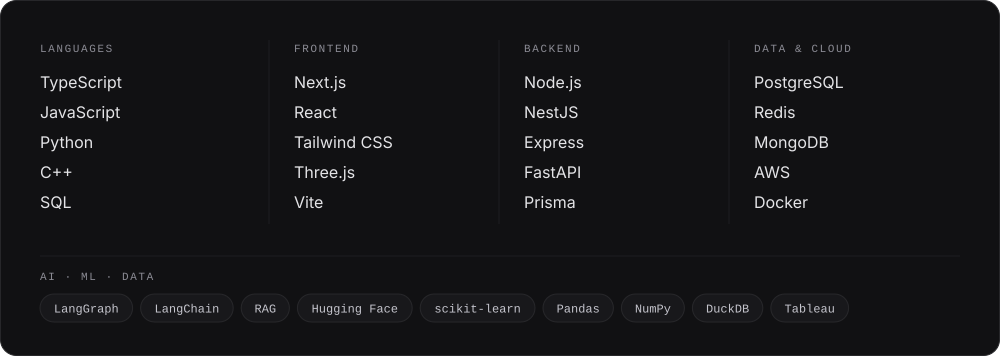

 

<a href="https://github.com/ManasSaxena14/HireFlow"></a>

&nbsp;&nbsp;

<table width="100%">
<tr>
<td width="50%" valign="top">
<a href="https://github.com/ManasSaxena14/FinSight-AI-Intelligent-Financial-Forecasting-Advisory-System"></a>

&nbsp;&nbsp;

</td>
<td width="50%" valign="top">
<a href="https://github.com/ManasSaxena14/BIDVERSE---AUCTION-PLATFORM"></a>

&nbsp;&nbsp;

</td>
</tr>
<tr>
<td width="50%" valign="top">
<a href="https://github.com/ManasSaxena14/Churnly"></a>

&nbsp;&nbsp;

</td>
<td width="50%" valign="top">

&nbsp;&nbsp;

</td>
</tr>
<tr>
<td width="50%" valign="top">

&nbsp;&nbsp;

</td>
<td width="50%" valign="top">
<a href="https://github.com/ManasSaxena14/RHoMIS-Analytics_DataAnalysis"></a>

&nbsp;&nbsp;

</td>
</tr>
</table>

 

<table width="100%">
<tr>
<td width="50%" valign="top">
<a href="https://github.com/ManasSaxena14/AuraRoast"></a>

&nbsp;&nbsp;

</td>
<td width="50%" valign="top">
<a href="https://github.com/ManasSaxena14/AXIOM_AI--LLM-"></a>

&nbsp;&nbsp;

</td>
</tr>
<tr>
<td width="50%" valign="top">

&nbsp;&nbsp;

</td>
<td width="50%" valign="top">
<a href="https://github.com/ManasSaxena14/TrafficFlowControl_AIML-DL_T036"></a>

&nbsp;&nbsp;

</td>
</tr>
</table>

 

  

<!-- Generated by scripts/build_stats.py and published to the output branch -->

<table width="100%">
<tr>
<td width="50%" valign="top"></td>
<td width="50%" valign="top"></td>
</tr>
</table>


<a href="https://leetcode.com/u/Manas-14"></a>

  

Open to internships and collaborations. If you have a hard problem, I'd like to hear about it.
  
&nbsp;&nbsp;
&nbsp;&nbsp;

 

